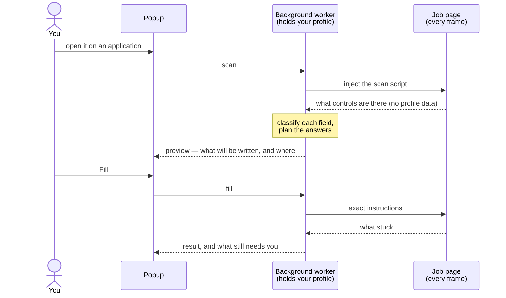

# Job Apply Assistant

A Chrome extension that fills in the repetitive parts of job application forms
from a profile you save once. It fills; **you** review and submit.

> **Status: work in progress.** The engine that reads a form, works out what
> each field is asking for and writes the answer is built and tested. The
> popup, the profile pages and the wiring between them are not built yet, so
> the extension installs but has nothing to click on today. See
> [Status](#status).

## Why

Every application asks for the same things: your name, e-mail, phone, links,
the same work-authorization questions, the same résumé. Typing them again
takes minutes. Getting one wrong — the wrong answer to "Will you require
sponsorship?" — can cost the job. This project automates the typing and is
deliberately cautious about everything else.

## The rules it is built around

| Rule | What that means in practice |
| --- | --- |
| **It never submits.** | It never clicks a button or a link and never ticks a checkbox. You press Submit. |
| **When unsure, it leaves the field alone and tells you.** | A blank field costs five seconds; a wrong answer can cost the job. A match must be exact and unique, never "close enough" — above all for work-authorization, sponsorship and demographic questions. |
| **It never overwrites you.** | Anything you already typed, chose or attached stays as it is. |
| **It never fills what you cannot see.** | Forms plant invisible "honeypot" fields to catch bots. Hidden fields are skipped. |
| **Your data stays in your browser.** | No server, no analytics, no remotely loaded code. |
| **Nothing runs until you ask.** | No content scripts are registered. The extension touches a page only after you open it on that page. |
| **You see it first.** | Every fill is previewed: what will be written, and where. |
| **The page never sees your profile.** | Code running inside the page only describes the form and carries out specific instructions. Your profile, your résumé and every decision stay in the extension's background worker. |

## How it works



The code is split in two, and the split is the point:

- **The trusted side** (`lib/*.ts`) is plain TypeScript with no DOM and no
  extension APIs. It holds the profile and makes every decision: what a field
  is, which option to choose, whether to write at all.
- **The page side** (`lib/page/*.ts`) runs inside the job site's page. It
  finds the form controls, describes them, checks that a person could see
  them, and writes exactly what it is told to. It never receives the profile.

Everything a page reports back is treated as untrusted: its shape is checked,
its lengths are capped, and it is only ever shown as plain text.

## What it understands

**Fields**

| Group | Fields |
| --- | --- |
| You | First name, last name, full name, e-mail, phone |
| Address | Street address, city, state or province, postal code, country |
| Links | LinkedIn, GitHub, portfolio or personal website |
| Work | Current company, current title |
| Education | School, degree, major, graduation date or year, GPA |
| Eligibility | Authorized to work, will need visa sponsorship |
| Voluntary self-identification | Gender, race or ethnicity, veteran status, disability status — only if you chose to save an answer |
| Documents | The résumé upload |

**Job sites.** Pages on Greenhouse, Lever, Ashby, Workday, iCIMS,
SmartRecruiters, Workable, BambooHR, Jobvite, Taleo and SAP SuccessFactors are
recognised by their address. The form handling itself is written against, and
tested with, markup copied from real Greenhouse, Lever and Ashby application
forms.

**Deliberate limits of version 1**

- Custom dropdowns and typeaheads (every dropdown on Greenhouse is one) are
  recognised and reported, not operated.
- The single "Location" box is never written: on the big job sites it is a
  typeahead.
- Nothing is written into free-text areas, and free-text questions are not
  answered.
- Checkboxes are never touched. Signature and attestation fields are never
  filled.
- Sign-in forms, payment fields, one-time-code fields and site search are
  ignored altogether.
- No multi-step forms (Workday), no date pickers, no LinkedIn or Indeed.

## Status

| Part | State |
| --- | --- |
| Recognising what a field asks for (`lib/classify.ts`) | Built, tested |
| Choosing an option in a dropdown or radio group (`lib/choices.ts`, `lib/regions.ts`) | Built for yes/no and self-identification questions. Choosing a state, country or school from a list is not built yet |
| The profile: validation, and the text for each field (`lib/profile.ts`) | Built, tested |
| The résumé file: format, size and type checks (`lib/resume.ts`) | Built, tested |
| On the page: finding controls, checking visibility, writing values (`lib/page/`) | Built, tested |
| On the page: describing a control — its label, options, whether it is answered (`lib/page/describe.ts`) | In progress |
| Guards for data coming back from a page (`lib/report.ts`), job-site detection (`lib/ats.ts`) | Built, tested |
| The planner that turns a scan into a preview and instructions (`lib/plan.ts`) | Not built |
| The injected scan and fill scripts, and the background worker's side of them | Not built |
| Storage | Not built |
| The popup (preview and result) | Not built |
| The profile and settings pages | Not built |

## Getting started

You need Node.js 22.12 or newer; `.nvmrc` pins the version the project is
developed on.

```sh
nvm use
npm ci
npm run dev
```

`npm run dev` builds the extension, opens a browser with it loaded and reloads
it when the code changes. Never put real personal data into a development
build.

To load a production build by hand:

```sh
npm run build
```

Then open `chrome://extensions`, turn on **Developer mode**, choose **Load
unpacked** and pick the `.output/chrome-mv3` folder.

## Commands

| Command | What it does |
| --- | --- |
| `npm run dev` | Development mode: build, open a browser with the extension loaded, reload on change |
| `npm run build` | Production build into `.output/chrome-mv3` |
| `npm run compile` | Type-check |
| `npm test` | Unit tests |
| `npm run test:e2e` | Build the test variant and run the Playwright tests in real Chromium |
| `npm run check` | All of the checks above |
| `npm run fixtures` | Serve the local test pages, to try the extension on them by hand |

## Project layout

```
entrypoints/         Thin WXT entry files (the background worker; popup and pages to come)
lib/                 The logic
  types.ts           Every shared type and function contract — read this first
  classify.ts        What is this field asking for?
  choices.ts         Which option says exactly what the profile says?
  regions.ts         Countries and US states, by every name and code forms use
  profile.ts         The saved profile: validation, and the text to type for a field
  resume.ts          The résumé file: storage format, size and type checks
  report.ts          What still needs you; guards for data coming back from a page
  ats.ts             Which job site an address belongs to
  page/              Code that runs inside the page
tests/unit/          Vitest, in jsdom
tests/e2e/           Playwright, real Chromium with the extension loaded
tests/fixtures/      Local pages shaped like real application forms
assets/              The shared look of the extension's own pages
page-blueprint/      A separate, standalone form-inspection extension (it has its own README)
docs/superpowers/    Design notes and plans for parts still to come
CLAUDE.md            The detailed project guide: rules, decisions, platform facts, conventions
```

## Testing

Recognising a field wrongly is worse than not recognising it, so the tests
lean the same way the code does: every rule is tested for what it must **not**
match as well as for what it must, using labels and markup copied from real
application forms.

- **Unit tests** (`npm test`) — more than 2,800 of them. They exercise the
  real code against a real DOM (jsdom); none of the project's own modules is
  mocked.
- **End-to-end tests** (`npm run test:e2e`) — Playwright drives real Chromium,
  for what jsdom cannot show: layout, visibility and the extension platform.
  The harness is set up; the specs themselves are still to be written.

Everyone in the tests is made up (Ada Lovelace, `ada@example.com`, `555-0100`
phone numbers). No real personal data belongs in this repository.

## Working on it

`CLAUDE.md` is the full guide. The short version:

- Work test-first: write the failing test, watch it fail for the right reason,
  then write the code. Table-driven tests with literal expected values.
- Precision over coverage. When a rule is in doubt, it does not match.
- TypeScript is strict. Imports are explicit; types are imported with
  `import type`.
- Each module exports constants typed with the contracts in `lib/types.ts`, so
  the compiler holds every module to the shape the others rely on.

## Built with

[WXT](https://wxt.dev) (Manifest V3), TypeScript, React 19 for the extension's
own pages, Vitest with jsdom, and Playwright.

## License

No license has been specified yet.
