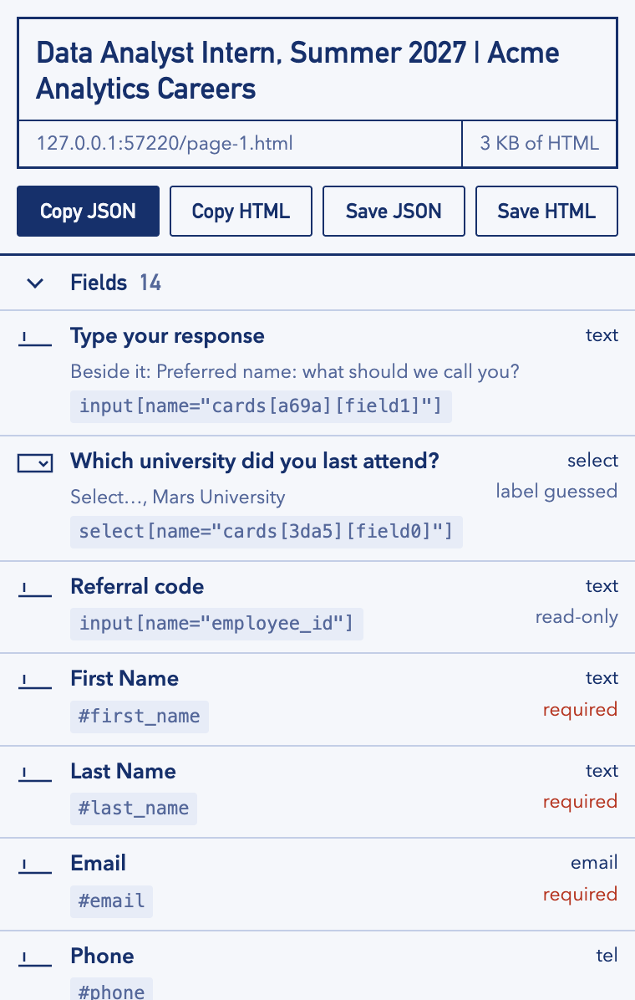
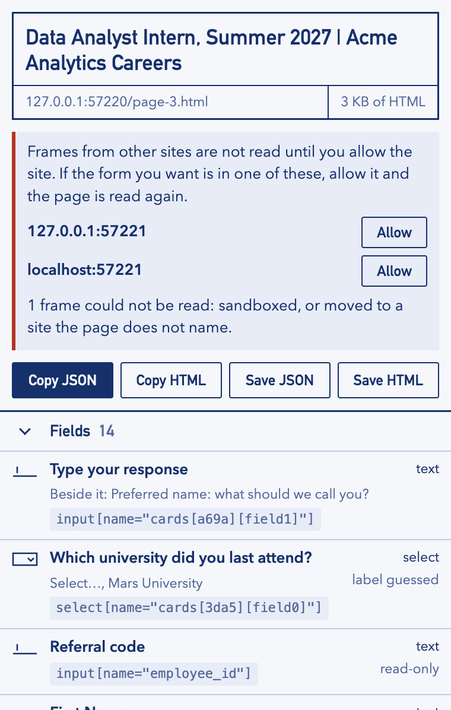

# Page Blueprint

A small Chrome extension that captures the page you are looking at: its HTML, plus a
structured list of its form fields, buttons, headings and links. You can copy or save either
one.

It is standalone: plain HTML, CSS and JavaScript, no build step, no dependencies. It lives in
this folder and shares nothing with the Job Apply Assistant project around it.



It follows your system's light or dark setting ([dark version](docs/popup-dark.png)).

## Load it in Chrome

1. Open `chrome://extensions`.
2. Turn on **Developer mode** (top right).
3. Click **Load unpacked** and choose the `extension/` folder inside this one.
4. Pin "Page Blueprint" from the puzzle-piece menu, open any page, and click its icon.

After changing the code, press the reload arrow on the extension's card.

## What it gives you

| Button | What you get |
| --- | --- |
| Copy JSON / Save JSON | Title, address, meta tags, JSON-LD, headings, links, forms, fields and buttons. No raw HTML. |
| Copy HTML / Save HTML | The page's HTML as it stands now (after scripts have run), shadow roots included. |

A field looks like this:

```json
{
  "label": "First name",
  "type": "text",
  "name": "first_name",
  "id": "fn",
  "selector": "#fn",
  "required": true,
  "disabled": false,
  "visible": true,
  "placeholder": "Ada",
  "autocomplete": "given-name",
  "form": 0
}
```

- `label` is the name the page itself gives the field: `aria-labelledby`, `aria-label`, a
  `<label>`, a custom radio, checkbox or switch's own text, or failing those the field's
  placeholder or title.
- `nearbyText` appears when the page gives the field no real name: it is the text sitting just
  before the field, which on many application forms is the actual question. It is a guess, so
  it is kept apart from `label` and never decides `required`. The popup heads a row with it
  only when there is no label at all, marked "label guessed".
- Radios that share a name (and checkboxes that do) come back as one field with `options`, as
  do custom radios inside a `role="radiogroup"`. Each option has its own `selector`.
- `visible: false` marks fields a person cannot see: not rendered, see-through, a pixel wide,
  parked off the page, or hidden from screen readers. That covers the usual honeypots, but
  not every way of hiding something (a field clipped by its container still counts as
  visible). File pickers, radios and checkboxes hidden behind a styled stand-in count as
  visible.
- `readonly: true` and `disabled: true` mark fields that cannot be changed.
- `required` is also true when the label carries an asterisk (`*` or `✱`), since many forms
  mark it only that way.
- `selector` prefers a test hook (`data-testid`, `data-automation-id` and the like), then the
  id, then the name, and otherwise spells out the position from the nearest ancestor that has
  one of those. A selector containing ` >>> ` crosses into a shadow root: `#host >>> #field`
  is the element matching `#field` inside the shadow root of `#host`.
- Clicking a selector in the popup copies it.

If part of a page cannot be read, the rest still comes back and `problems` says which part
and why; the popup shows the same.

### Frames

Frames the extension is allowed to read are read automatically and listed under `frames`;
each says where it sits with `framePath` (`[1, 0]` is the first frame inside the page's
second frame). Under Chrome's rules that means frames from the page's own site, plus any
site you have allowed.

When a sizeable frame was skipped, the popup lists the site it points at with its own
**Allow** button, which asks Chrome for that one site and then reads the page again. Where
allowing cannot help, it says so instead: a frame that was redirected to a site the page does
not name, a sandboxed frame, or a site that is already allowed. The same list is in the JSON
as `unreadFrames`.



### What it does not do

- It never runs until you click it, and nothing it captures leaves your browser.
- It does not record what you typed into fields. The HTML can still contain typed text on
  sites that mirror it into the markup. Values of password fields are blanked, including one
  switched to plain text by a "show password" button if it is marked as a password field;
  this is a safeguard, not a guarantee, so look before you share a capture of a sign-in page.
- Chrome's own pages (`chrome://…`, the Web Store, the PDF viewer) cannot be read.

## Tests

```bash
npm test
```

Needs Node 22 or newer and a Chromium to drive: the one in Playwright's cache is found
automatically, or point `CHROME_PATH` at a Chromium or Chrome for Testing binary. The tests
load the real extension, click its toolbar button and read the popup. The extension itself
needs Chrome 125 or newer; it has been run on 148.

## Layout

- `extension/` is the extension. `extract.js` runs inside the page, `capture.js` assembles
  and exports the result, and `popup.*` is the window you see.
- `tests/` holds the tests and their two small helpers (a browser driver and a web server).
- `scripts/make-icons.js` redraws the PNG icons from `extension/icons/icon.svg`.
